  <a href="https://pixel-cursor.com">pixel-cursor.com</a>
  &nbsp;·&nbsp;
  <a href="https://www.youtube.com/@PixelCursor">YouTube</a>
  &nbsp;·&nbsp;
  <a href="https://www.tiktok.com/@pixelcursor">TikTok</a>
  &nbsp;·&nbsp;
  <a href="https://patreon.com/PixelCursor">Patreon</a>

PixelCursor is a one-person studio for apps, games and tools. I decide what gets built and how it should feel. A crew of Claude agents writes most of the code. Everything on this page is live.

  
  
  

  Every graphic here is plain SVG, drawn by the scripts in this repo. No trackers, no images from elsewhere. 
  Need a break? <a href="https://derendboss.github.io/DerEndboss/">Play Clawd Coin Run</a>.

